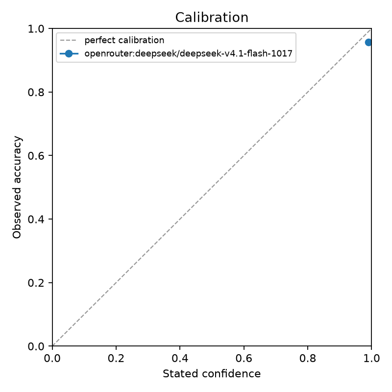

# MathScanBench results

## Accuracy

| Model | Correct | Wrong with confidence ≥ 80% |
|---|---|---|
| openrouter:deepseek/deepseek-v4.1-flash-1017 | 96% (379/396) | 4% (17/396) |

## By topic

| Topic | openrouter:deepseek/deepseek-v4.1-flash-1017 |
|---|---|
| algebra | 50% (4/8) |
| arithmetic | 57% (4/7) |
| axial | 100% (5/5) |
| beams | 100% (10/10) |
| brittle-fracture | 100% (5/5) |
| central-force | 100% (10/10) |
| decimals | 100% (6/6) |
| dispersion | 100% (5/5) |
| dynamic-fracture | 100% (5/5) |
| dynamics | 90% (9/10) |
| elastic-plastic-fracture | 100% (5/5) |
| equations | 100% (1/1) |
| exponential-equations | 67% (2/3) |
| exponential-inequalities | 80% (4/5) |
| expressions | 100% (2/2) |
| fatigue | 100% (5/5) |
| fractions | 100% (2/2) |
| fracture | 100% (50/50) |
| geometry | 100% (4/4) |
| impact | 100% (10/10) |
| inequalities | 100% (1/1) |
| irrational-equations | 100% (4/4) |
| irrational-inequalities | 100% (2/2) |
| lagrangian | 100% (15/15) |
| limit-analysis | 100% (25/25) |
| linear-equations | 77% (17/22) |
| logarithmic-inequalities | 100% (2/2) |
| logarithms | 100% (9/9) |
| mixed-mode | 100% (5/5) |
| non-inertial | 100% (5/5) |
| number-sets | 100% (1/1) |
| parameters | 100% (1/1) |
| plastic-waves | 100% (5/5) |
| plasticity | 100% (30/30) |
| powers | 100% (1/1) |
| quadratics | 100% (2/2) |
| ratio | 100% (1/1) |
| rational-equations | 100% (1/1) |
| rigid-body | 100% (35/35) |
| roots | 50% (1/2) |
| slip-line | 100% (5/5) |
| stability | 100% (5/5) |
| stereometry | 100% (1/1) |
| systems | 100% (3/3) |
| torsion | 100% (5/5) |
| waves | 100% (45/45) |
| word-problems | 80% (4/5) |

## By difficulty

| Difficulty | openrouter:deepseek/deepseek-v4.1-flash-1017 |
|---|---|
| 1 | 89% (116/130) |
| 2 | 99% (90/91) |
| 3 | 99% (94/95) |
| 4 | 98% (58/59) |
| 5 | 100% (21/21) |

## By input (text vs image)

| Input | openrouter:deepseek/deepseek-v4.1-flash-1017 |
|---|---|
| image | 83% (80/96) |
| text | 100% (299/300) |

## Confidently wrong answers

| Model | Problem | Answer given | Reference | Confidence |
|---|---|---|---|---|
| openrouter:deepseek/deepseek-v4.1-flash-1017 | s1-171718-1 | 56 | 58 | 92% |
| openrouter:deepseek/deepseek-v4.1-flash-1017 | s1-171721-2 | 80 | 28 | 95% |
| openrouter:deepseek/deepseek-v4.1-flash-1017 | s1-171723-1 | 462 | 154 | 96% |
| openrouter:deepseek/deepseek-v4.1-flash-1017 | s1-171723-3 | 5.9 | 28 | 95% |
| openrouter:deepseek/deepseek-v4.1-flash-1017 | s1-171724-1 | 6 | 194 | 95% |
| openrouter:deepseek/deepseek-v4.1-flash-1017 | s2-171925-1 | -2*h | 2*h | 98% |
| openrouter:deepseek/deepseek-v4.1-flash-1017 | s2-171929-1 | -24 | 30 | 85% |
| openrouter:deepseek/deepseek-v4.1-flash-1017 | s2-224001-1 | 4004 | 2421 | 100% |
| openrouter:deepseek/deepseek-v4.1-flash-1017 | s3-171556-1 | 20*b | -6*b | 85% |
| openrouter:deepseek/deepseek-v4.1-flash-1017 | s3-171556-2 | 1 | 31*a | 80% |
| openrouter:deepseek/deepseek-v4.1-flash-1017 | s3-171558-1 | 66/7 | 102 | 98% |
| openrouter:deepseek/deepseek-v4.1-flash-1017 | s3-171603-2 | 240 | 221 | 95% |
| openrouter:deepseek/deepseek-v4.1-flash-1017 | s4-170342-1 | Union(Interval.open(-oo, 1), Interval.open(log(5, 4), oo)) | Union(Interval(-oo, 0), Interval.open(log(5)/log(7), 1)) | 98% |
| openrouter:deepseek/deepseek-v4.1-flash-1017 | s4-170357-1 | 3*sqrt(2)/4 | 3*sqrt(2)/8 | 99% |
| openrouter:deepseek/deepseek-v4.1-flash-1017 | s4-170406-2 | a**(3/4) | a**(Rational(1, 6)) | 95% |
| openrouter:deepseek/deepseek-v4.1-flash-1017 | axial-suddenly-applied-load | 1.962e6 Pa | 1.962e+07 Pa | 100% |
| openrouter:deepseek/deepseek-v4.1-flash-1017 | s3-171559-2 | 624 | 124 | 92% |

## Calibration

## Verification

Can a verifier model spot wrong solutions without seeing the reference answer?

| Verifier | Solver | Wrong solutions caught | Correct solutions rejected |
|---|---|---|---|
| openrouter:deepseek/deepseek-v4.1-flash-1017 | openrouter:deepseek/deepseek-v4.1-flash-1017 | 100% (1/1) | 0% (0/299) |
| openrouter:deepseek/deepseek-v4.1-flash-1017 | student | 57% (8/14) | 7% (5/68) |

Wrong solutions the verifier accepted: s3-171548-1, s3-171613-1, s4-170406-1, s1-171718-1, s2-171925-1, s2-171929-1
