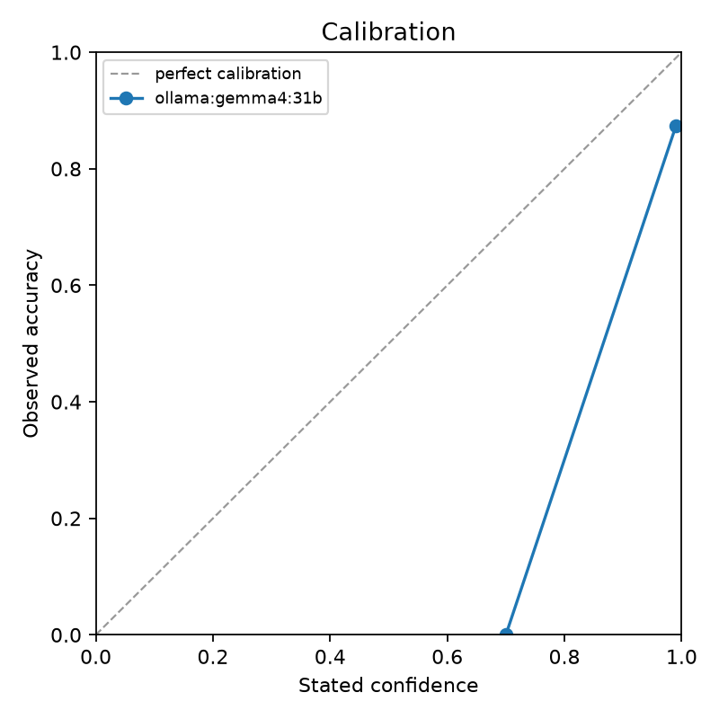

# MathScanBench results

## Accuracy

| Model | Correct | Wrong with confidence ≥ 80% |
|---|---|---|
| ollama:gemma4:31b | 87% (345/396) | 13% (50/396) |

## By topic

| Topic | ollama:gemma4:31b |
|---|---|
| algebra | 88% (7/8) |
| arithmetic | 29% (2/7) |
| axial | 100% (5/5) |
| beams | 100% (10/10) |
| brittle-fracture | 60% (3/5) |
| central-force | 100% (10/10) |
| decimals | 100% (6/6) |
| dispersion | 100% (5/5) |
| dynamic-fracture | 80% (4/5) |
| dynamics | 100% (10/10) |
| elastic-plastic-fracture | 0% (0/5) |
| equations | 100% (1/1) |
| exponential-equations | 67% (2/3) |
| exponential-inequalities | 80% (4/5) |
| expressions | 100% (2/2) |
| fatigue | 100% (5/5) |
| fractions | 0% (0/2) |
| fracture | 98% (49/50) |
| geometry | 100% (4/4) |
| impact | 50% (5/10) |
| inequalities | 100% (1/1) |
| irrational-equations | 75% (3/4) |
| irrational-inequalities | 0% (0/2) |
| lagrangian | 100% (15/15) |
| limit-analysis | 80% (20/25) |
| linear-equations | 77% (17/22) |
| logarithmic-inequalities | 50% (1/2) |
| logarithms | 89% (8/9) |
| mixed-mode | 100% (5/5) |
| non-inertial | 100% (5/5) |
| number-sets | 100% (1/1) |
| parameters | 0% (0/1) |
| plastic-waves | 80% (4/5) |
| plasticity | 87% (26/30) |
| powers | 100% (1/1) |
| quadratics | 100% (2/2) |
| ratio | 100% (1/1) |
| rational-equations | 100% (1/1) |
| rigid-body | 100% (35/35) |
| roots | 50% (1/2) |
| slip-line | 0% (0/5) |
| stability | 100% (5/5) |
| stereometry | 100% (1/1) |
| systems | 100% (3/3) |
| torsion | 100% (5/5) |
| waves | 100% (45/45) |
| word-problems | 100% (5/5) |

## By difficulty

| Difficulty | ollama:gemma4:31b |
|---|---|
| 1 | 89% (116/130) |
| 2 | 92% (84/91) |
| 3 | 98% (93/95) |
| 4 | 66% (39/59) |
| 5 | 62% (13/21) |

## By input (text vs image)

| Input | ollama:gemma4:31b |
|---|---|
| image | 77% (74/96) |
| text | 90% (271/300) |

## Confidently wrong answers

| Model | Problem | Answer given | Reference | Confidence |
|---|---|---|---|---|
| ollama:gemma4:31b | s1-171718-2 | 56 | 0 | 90% |
| ollama:gemma4:31b | s1-171721-1 | 0 | 10 | 90% |
| ollama:gemma4:31b | s1-171721-2 | 34 | 28 | 100% |
| ollama:gemma4:31b | s1-171723-1 | 462 | 154 | 100% |
| ollama:gemma4:31b | s1-171723-3 | 38 | 28 | 90% |
| ollama:gemma4:31b | s2-171925-2 | 6*x + 8*y | 10*x - 7*y | 90% |
| ollama:gemma4:31b | s2-223945-1 | 87643 | 7.484e+04 | 100% |
| ollama:gemma4:31b | s2-223945-2 | 21042 | 8.764e+04 | 100% |
| ollama:gemma4:31b | s2-224001-2 | 4004 | 3770 | 100% |
| ollama:gemma4:31b | s3-171552-1 | -61/99 | -35/36 | 100% |
| ollama:gemma4:31b | s3-171558-1 | 81.6 | 102 | 100% |
| ollama:gemma4:31b | s3-171559-1 | 3500 | 35 | 100% |
| ollama:gemma4:31b | s3-171610-1 | 899/25 | 13/12 | 80% |
| ollama:gemma4:31b | s4-170336-1 | Interval(-2, 0) | Interval.open(-2, 0) | 85% |
| ollama:gemma4:31b | s4-170341-1 | Interval(-3, 5) | Union(Interval.open(0, 1), FiniteSet(4), Interval.open(32, oo)) | 90% |
| ollama:gemma4:31b | s4-170342-1 | Union(Interval(-oo, 1), Interval(log(5, 4), log(6, 4)), Interval(log(7, 4), log(9, 4))) | Union(Interval(-oo, 0), Interval.open(log(5)/log(7), 1)) | 90% |
| ollama:gemma4:31b | s4-170357-1 | 1 | 3*sqrt(2)/8 | 90% |
| ollama:gemma4:31b | s4-170402-2 | FiniteSet((-3 + sqrt(13))/2) | FiniteSet(0) | 100% |
| ollama:gemma4:31b | s4-170402-3 | Interval(-11, 5) | Interval.Lopen(-11, 5) | 100% |
| ollama:gemma4:31b | s4-170403-1 | Interval(11, oo) | Interval.open(11, oo) | 100% |
| ollama:gemma4:31b | s4-170406-2 | a**(3/16) | a**(Rational(1, 6)) | 90% |
| ollama:gemma4:31b | s4-170412-1 | 9/2 | 15/2 | 90% |
| ollama:gemma4:31b | frac-weibull-size-effect | 249765900 Pa | 2.437e+08 Pa | 100% |
| ollama:gemma4:31b | frac-weibull-size-effect | 249765900 Pa | 2.437e+08 Pa | 100% |
| ollama:gemma4:31b | frac-dcb-fixed-grip | 3*E*b*h**3*delta**2/(16*a**4) | 3*E*h**3*delta**2/(16*a**4) | 100% |
| ollama:gemma4:31b | frac-dugdale-ctod | 2.244e-5 m | 1.765e-05 m | 100% |
| ollama:gemma4:31b | frac-dugdale-ctod | 1.273e-5 m | 1.765e-05 m | 85% |
| ollama:gemma4:31b | frac-dugdale-ctod | 1.0547e-5 m | 1.765e-05 m | 100% |
| ollama:gemma4:31b | frac-dugdale-ctod | 1.8006e-5 m | 1.765e-05 m | 95% |
| ollama:gemma4:31b | frac-dugdale-ctod | 2.109e-5 m | 1.765e-05 m | 95% |
| ollama:gemma4:31b | plast-considere-uts | 301991525 Pa | 2.967e+08 Pa | 100% |
| ollama:gemma4:31b | plast-kinematic-hardening-reverse-yield | 114285714 Pa | 1.1e+08 Pa | 100% |
| ollama:gemma4:31b | plast-propped-cantilever-udl | 16*Mp/L**2 | (6 + 4*sqrt(2))*Mp/L**2 | 100% |
| ollama:gemma4:31b | plast-prandtl-punch | 692820323 Pa | 8.906e+08 Pa | 85% |
| ollama:gemma4:31b | plast-prandtl-punch | 566933371 Pa | 8.906e+08 Pa | 85% |
| ollama:gemma4:31b | plast-prandtl-punch | 600000000 Pa | 8.906e+08 Pa | 80% |
| ollama:gemma4:31b | plast-prandtl-punch | 1157142857 Pa | 8.906e+08 Pa | 80% |
| ollama:gemma4:31b | plast-portal-frame-collapse | 200000 N | 1.5e+05 N | 100% |
| ollama:gemma4:31b | plast-portal-frame-collapse | 200000 N | 1.5e+05 N | 100% |
| ollama:gemma4:31b | plast-portal-frame-collapse | 200000 N | 1.5e+05 N | 100% |

## Calibration

## Verification

Can a verifier model spot wrong solutions without seeing the reference answer?

| Verifier | Solver | Wrong solutions caught | Correct solutions rejected |
|---|---|---|---|
| ollama:gemma4:31b | ollama:gemma4:31b | 34% (10/29) | 1% (2/271) |
| ollama:gemma4:31b | student | 79% (11/14) | 22% (15/68) |

Wrong solutions the verifier accepted: frac-dcb-fixed-grip, frac-dugdale-ctod, frac-weibull-size-effect, s3-171613-1, s4-170406-1, plast-kinematic-hardening-reverse-yield, plast-portal-frame-collapse, plast-prandtl-punch, plast-thick-cylinder-partial-yield, s2-171925-1, wave-hertz-sphere-collision-duration, wave-spall-triangular-pulse, wave-von-karman-critical-velocity
