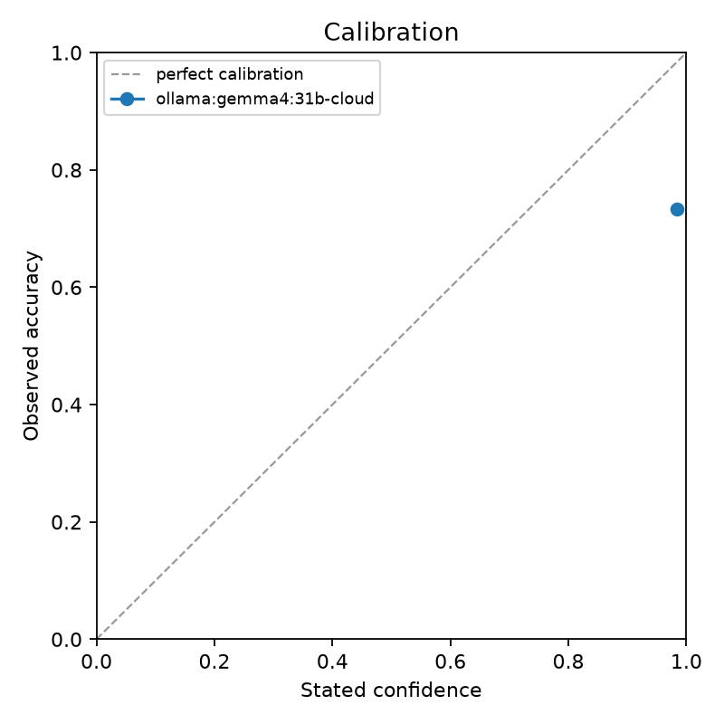

# MathScanBench results

## Accuracy

| Model | Correct | Wrong with confidence ≥ 80% |
|---|---|---|
| ollama:gemma4:31b-cloud | 73% (33/45) | 27% (12/45) |

## By topic

| Topic | ollama:gemma4:31b-cloud |
|---|---|
| algebra | 83% (5/6) |
| arithmetic | 17% (1/6) |
| equations | 100% (1/1) |
| expressions | 100% (2/2) |
| fractions | 0% (0/1) |
| geometry | 100% (1/1) |
| linear-equations | 76% (16/21) |
| ratio | 100% (1/1) |
| systems | 100% (3/3) |
| word-problems | 100% (3/3) |

## By difficulty

| Difficulty | ollama:gemma4:31b-cloud |
|---|---|
| 1 | 72% (29/40) |
| 2 | 80% (4/5) |

## Confidently wrong answers

| Model | Problem | Answer given | Reference | Confidence |
|---|---|---|---|---|
| ollama:gemma4:31b-cloud | s1-171718-2 | 56 | 0 | 90% |
| ollama:gemma4:31b-cloud | s1-171721-1 | 0 | 10 | 90% |
| ollama:gemma4:31b-cloud | s1-171721-2 | 34 | 28 | 100% |
| ollama:gemma4:31b-cloud | s1-171723-1 | 462 | 154 | 100% |
| ollama:gemma4:31b-cloud | s1-171723-3 | 38 | 28 | 90% |
| ollama:gemma4:31b-cloud | s2-171925-2 | 6*x + 8*y | 10*x - 7*y | 90% |
| ollama:gemma4:31b-cloud | s2-223945-1 | 87643 | 7.484e+04 | 100% |
| ollama:gemma4:31b-cloud | s2-223945-2 | 21042 | 8.764e+04 | 100% |
| ollama:gemma4:31b-cloud | s2-224001-2 | 4004 | 3770 | 100% |
| ollama:gemma4:31b-cloud | s3-171552-1 | -61/99 | -35/36 | 100% |
| ollama:gemma4:31b-cloud | s3-171558-1 | 81.6 | 102 | 100% |
| ollama:gemma4:31b-cloud | s3-171559-1 | 3500 | 35 | 100% |

## Calibration

