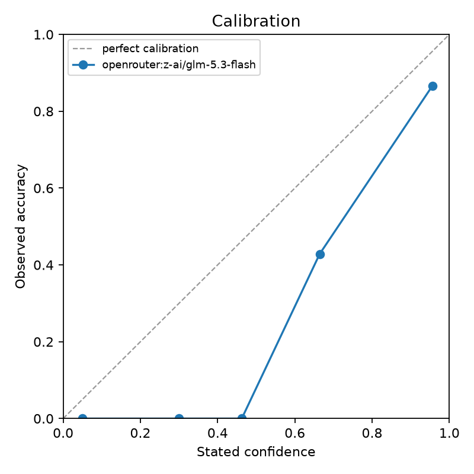

# MathScanBench results

## Accuracy

| Model | Correct | Wrong with confidence ≥ 80% |
|---|---|---|
| openrouter:z-ai/glm-5.3-flash | 77% (74/96) | 11% (11/96) |

## By topic

| Topic | openrouter:z-ai/glm-5.3-flash |
|---|---|
| algebra | 62% (5/8) |
| arithmetic | 71% (5/7) |
| decimals | 100% (6/6) |
| equations | 100% (1/1) |
| exponential-equations | 100% (3/3) |
| exponential-inequalities | 40% (2/5) |
| expressions | 100% (2/2) |
| fractions | 0% (0/2) |
| geometry | 75% (3/4) |
| inequalities | 100% (1/1) |
| irrational-equations | 75% (3/4) |
| irrational-inequalities | 50% (1/2) |
| linear-equations | 59% (13/22) |
| logarithmic-inequalities | 100% (2/2) |
| logarithms | 100% (9/9) |
| number-sets | 100% (1/1) |
| parameters | 100% (1/1) |
| powers | 100% (1/1) |
| quadratics | 100% (2/2) |
| ratio | 100% (1/1) |
| rational-equations | 100% (1/1) |
| roots | 100% (2/2) |
| stereometry | 100% (1/1) |
| systems | 100% (3/3) |
| word-problems | 100% (5/5) |

## By difficulty

| Difficulty | openrouter:z-ai/glm-5.3-flash |
|---|---|
| 1 | 77% (54/70) |
| 2 | 81% (13/16) |
| 3 | 60% (3/5) |
| 4 | 75% (3/4) |
| 5 | 100% (1/1) |

## Confidently wrong answers

| Model | Problem | Answer given | Reference | Confidence |
|---|---|---|---|---|
| openrouter:z-ai/glm-5.3-flash | s1-171718-1 | 0 | 58 | 98% |
| openrouter:z-ai/glm-5.3-flash | s1-171724-2 | 169 | 469 | 99% |
| openrouter:z-ai/glm-5.3-flash | s1-171728-2 | 30 | 27 | 95% |
| openrouter:z-ai/glm-5.3-flash | s2-171925-1 | 8*h | 2*h | 98% |
| openrouter:z-ai/glm-5.3-flash | s2-224001-1 | 18626 | 2421 | 90% |
| openrouter:z-ai/glm-5.3-flash | s3-171559-1 | 350 | 35 | 95% |
| openrouter:z-ai/glm-5.3-flash | s4-170339-1 | Union(Interval(-oo, 1), Interval.Lopen(2, 3)) | Union(Interval(-oo, 1), Interval.open(2, 3)) | 96% |
| openrouter:z-ai/glm-5.3-flash | s4-170342-1 | Union(Interval.Lopen(1, log(83, 17)/log(4)), Interval.open(log(5, 4), oo)) | Union(Interval(-oo, 0), Interval.open(log(5)/log(7), 1)) | 88% |
| openrouter:z-ai/glm-5.3-flash | s4-170402-3 | Interval.open(-11, 5) | Interval.Lopen(-11, 5) | 95% |
| openrouter:z-ai/glm-5.3-flash | s4-170404-2 | FiniteSet(0, (cbrt(2) - 1)**2/9) | EmptySet | 85% |
| openrouter:z-ai/glm-5.3-flash | s3-171546-2 | 10.4 | 5 | 85% |

## Calibration

## Verification

Can a verifier model spot wrong solutions without seeing the reference answer?

| Verifier | Solver | Wrong solutions caught | Correct solutions rejected |
|---|---|---|---|
| openrouter:z-ai/glm-5.3-flash | student | 64% (9/14) | 10% (7/68) |

Wrong solutions the verifier accepted: s3-171613-1, s4-170347-1, s4-170406-1, s1-171718-1, s2-171925-1
