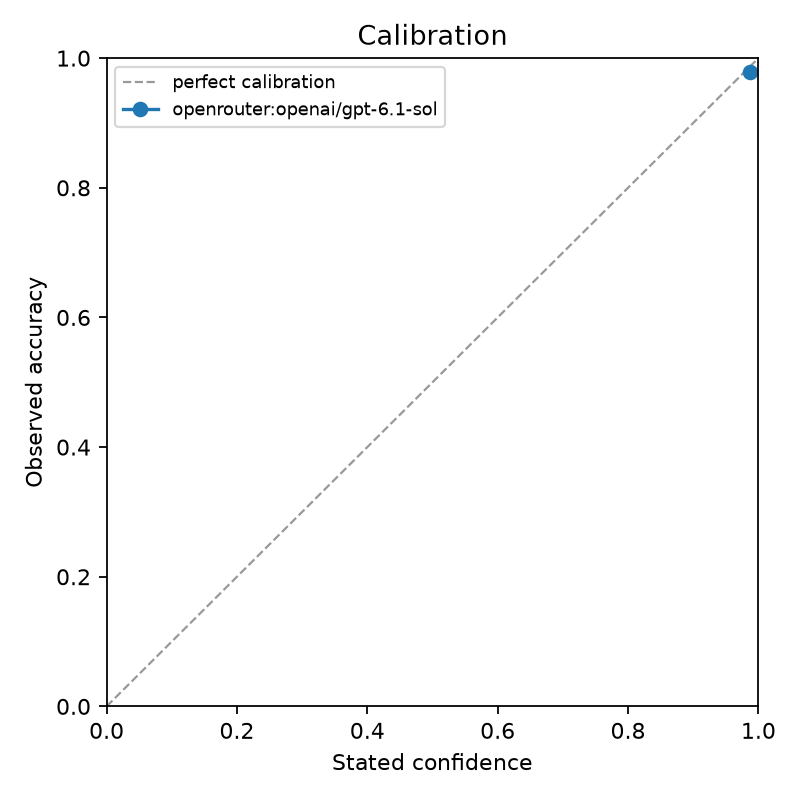

# MathScanBench results

## Accuracy

| Model | Correct | Wrong with confidence ≥ 80% |
|---|---|---|
| openrouter:openai/gpt-6.1-sol | 98% (94/96) | 2% (2/96) |

## By topic

| Topic | openrouter:openai/gpt-6.1-sol |
|---|---|
| algebra | 100% (8/8) |
| arithmetic | 86% (6/7) |
| decimals | 100% (6/6) |
| equations | 100% (1/1) |
| exponential-equations | 100% (3/3) |
| exponential-inequalities | 100% (5/5) |
| expressions | 100% (2/2) |
| fractions | 100% (2/2) |
| geometry | 100% (4/4) |
| inequalities | 100% (1/1) |
| irrational-equations | 100% (4/4) |
| irrational-inequalities | 100% (2/2) |
| linear-equations | 95% (21/22) |
| logarithmic-inequalities | 100% (2/2) |
| logarithms | 100% (9/9) |
| number-sets | 100% (1/1) |
| parameters | 100% (1/1) |
| powers | 100% (1/1) |
| quadratics | 100% (2/2) |
| ratio | 100% (1/1) |
| rational-equations | 100% (1/1) |
| roots | 100% (2/2) |
| stereometry | 100% (1/1) |
| systems | 100% (3/3) |
| word-problems | 100% (5/5) |

## By difficulty

| Difficulty | openrouter:openai/gpt-6.1-sol |
|---|---|
| 1 | 97% (68/70) |
| 2 | 100% (16/16) |
| 3 | 100% (5/5) |
| 4 | 100% (4/4) |
| 5 | 100% (1/1) |

## Confidently wrong answers

| Model | Problem | Answer given | Reference | Confidence |
|---|---|---|---|---|
| openrouter:openai/gpt-6.1-sol | s1-171721-2 | 34 | 28 | 85% |
| openrouter:openai/gpt-6.1-sol | s3-171558-1 | 66/7 | 102 | 85% |

## Calibration

## Verification

Can a verifier model spot wrong solutions without seeing the reference answer?

| Verifier | Solver | Wrong solutions caught | Correct solutions rejected |
|---|---|---|---|
| openrouter:openai/gpt-6.1-sol | student | 86% (12/14) | 3% (2/68) |

Wrong solutions the verifier accepted: s4-170406-1, s2-171929-1
