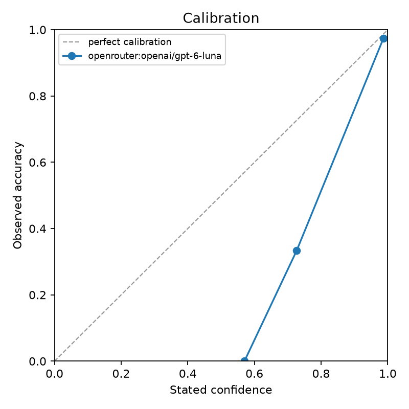

# MathScanBench results

## Accuracy

| Model | Correct | Wrong with confidence ≥ 80% |
|---|---|---|
| openrouter:openai/gpt-6-luna | 97% (383/396) | 3% (10/396) |

## By topic

| Topic | openrouter:openai/gpt-6-luna |
|---|---|
| algebra | 75% (6/8) |
| arithmetic | 86% (6/7) |
| axial | 100% (5/5) |
| beams | 100% (10/10) |
| brittle-fracture | 100% (5/5) |
| central-force | 100% (10/10) |
| decimals | 100% (6/6) |
| dispersion | 100% (5/5) |
| dynamic-fracture | 100% (5/5) |
| dynamics | 90% (9/10) |
| elastic-plastic-fracture | 100% (5/5) |
| equations | 100% (1/1) |
| exponential-equations | 67% (2/3) |
| exponential-inequalities | 100% (5/5) |
| expressions | 100% (2/2) |
| fatigue | 100% (5/5) |
| fractions | 100% (2/2) |
| fracture | 98% (49/50) |
| geometry | 100% (4/4) |
| impact | 90% (9/10) |
| inequalities | 100% (1/1) |
| irrational-equations | 100% (4/4) |
| irrational-inequalities | 100% (2/2) |
| lagrangian | 100% (15/15) |
| limit-analysis | 100% (25/25) |
| linear-equations | 77% (17/22) |
| logarithmic-inequalities | 100% (2/2) |
| logarithms | 100% (9/9) |
| mixed-mode | 100% (5/5) |
| non-inertial | 100% (5/5) |
| number-sets | 100% (1/1) |
| parameters | 100% (1/1) |
| plastic-waves | 100% (5/5) |
| plasticity | 100% (30/30) |
| powers | 0% (0/1) |
| quadratics | 100% (2/2) |
| ratio | 100% (1/1) |
| rational-equations | 100% (1/1) |
| rigid-body | 100% (35/35) |
| roots | 100% (2/2) |
| slip-line | 100% (5/5) |
| stability | 100% (5/5) |
| stereometry | 100% (1/1) |
| systems | 100% (3/3) |
| torsion | 100% (5/5) |
| waves | 100% (45/45) |
| word-problems | 100% (5/5) |

## By difficulty

| Difficulty | openrouter:openai/gpt-6-luna |
|---|---|
| 1 | 93% (121/130) |
| 2 | 98% (89/91) |
| 3 | 99% (94/95) |
| 4 | 100% (59/59) |
| 5 | 95% (20/21) |

## By input (text vs image)

| Input | openrouter:openai/gpt-6-luna |
|---|---|
| image | 90% (86/96) |
| text | 99% (297/300) |

## Confidently wrong answers

| Model | Problem | Answer given | Reference | Confidence |
|---|---|---|---|---|
| openrouter:openai/gpt-6-luna | s1-171718-2 | 56 | 0 | 80% |
| openrouter:openai/gpt-6-luna | s1-171723-3 | 38 | 28 | 93% |
| openrouter:openai/gpt-6-luna | s1-171728-2 | -3 | 27 | 87% |
| openrouter:openai/gpt-6-luna | s2-171925-1 | -2*h | 2*h | 98% |
| openrouter:openai/gpt-6-luna | s3-171559-1 | -1.2 | 35 | 88% |
| openrouter:openai/gpt-6-luna | s4-170356-1 | -0.6796647078 | -5 | 93% |
| openrouter:openai/gpt-6-luna | s4-170357-1 | 3*sqrt(2)/4 | 3*sqrt(2)/8 | 94% |
| openrouter:openai/gpt-6-luna | frac-g-from-k-plane-strain | 7.28×10^6 J/m^2 | 7280 J/m^2 | 100% |
| openrouter:openai/gpt-6-luna | axial-suddenly-applied-load | 196200000 Pa | 1.962e+07 Pa | 100% |
| openrouter:openai/gpt-6-luna | wave-hertz-sphere-collision-duration | 6.29e-5 s | 6.135e-05 s | 99% |

## Calibration

## Verification

Can a verifier model spot wrong solutions without seeing the reference answer?

| Verifier | Solver | Wrong solutions caught | Correct solutions rejected |
|---|---|---|---|
| openrouter:openai/gpt-6-luna | openrouter:openai/gpt-6-luna | 67% (2/3) | 2% (5/297) |
| openrouter:openai/gpt-6-luna | student | 64% (9/14) | 3% (2/68) |

Wrong solutions the verifier accepted: s4-170406-1, s1-171718-1, s1-171723-3, s2-171925-1, s2-171929-1, wave-hertz-sphere-collision-duration
