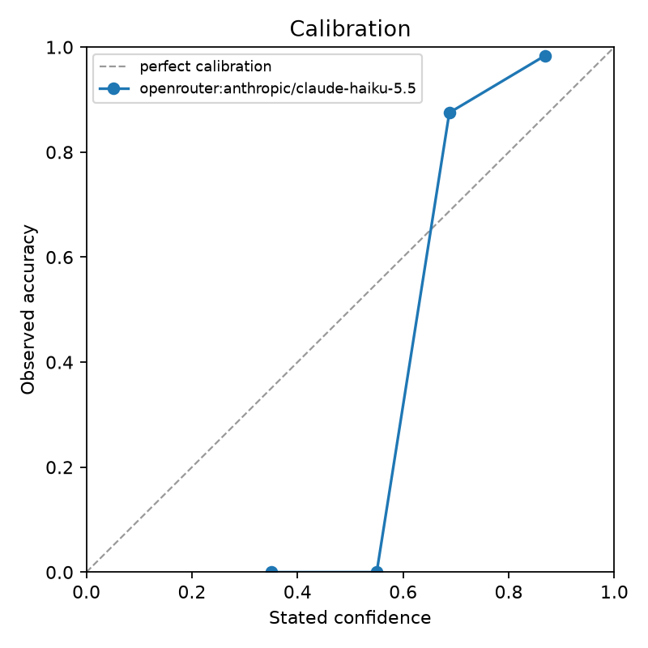

# MathScanBench results

## Accuracy

| Model | Correct | Wrong with confidence ≥ 80% |
|---|---|---|
| openrouter:anthropic/claude-haiku-5.5 | 97% (383/396) | 2% (6/396) |

## By topic

| Topic | openrouter:anthropic/claude-haiku-5.5 |
|---|---|
| algebra | 88% (7/8) |
| arithmetic | 86% (6/7) |
| axial | 100% (5/5) |
| beams | 100% (10/10) |
| brittle-fracture | 100% (5/5) |
| central-force | 100% (10/10) |
| decimals | 100% (6/6) |
| dispersion | 100% (5/5) |
| dynamic-fracture | 100% (5/5) |
| dynamics | 100% (10/10) |
| elastic-plastic-fracture | 100% (5/5) |
| equations | 100% (1/1) |
| exponential-equations | 67% (2/3) |
| exponential-inequalities | 80% (4/5) |
| expressions | 100% (2/2) |
| fatigue | 100% (5/5) |
| fractions | 100% (2/2) |
| fracture | 100% (50/50) |
| geometry | 100% (4/4) |
| impact | 100% (10/10) |
| inequalities | 100% (1/1) |
| irrational-equations | 75% (3/4) |
| irrational-inequalities | 100% (2/2) |
| lagrangian | 100% (15/15) |
| limit-analysis | 100% (25/25) |
| linear-equations | 91% (20/22) |
| logarithmic-inequalities | 100% (2/2) |
| logarithms | 100% (9/9) |
| mixed-mode | 100% (5/5) |
| non-inertial | 100% (5/5) |
| number-sets | 100% (1/1) |
| parameters | 100% (1/1) |
| plastic-waves | 100% (5/5) |
| plasticity | 97% (29/30) |
| powers | 100% (1/1) |
| quadratics | 100% (2/2) |
| ratio | 100% (1/1) |
| rational-equations | 100% (1/1) |
| rigid-body | 100% (35/35) |
| roots | 50% (1/2) |
| slip-line | 80% (4/5) |
| stability | 80% (4/5) |
| stereometry | 100% (1/1) |
| systems | 100% (3/3) |
| torsion | 100% (5/5) |
| waves | 96% (43/45) |
| word-problems | 100% (5/5) |

## By difficulty

| Difficulty | openrouter:anthropic/claude-haiku-5.5 |
|---|---|
| 1 | 96% (125/130) |
| 2 | 95% (86/91) |
| 3 | 99% (94/95) |
| 4 | 97% (57/59) |
| 5 | 100% (21/21) |

## By input (text vs image)

| Input | openrouter:anthropic/claude-haiku-5.5 |
|---|---|
| image | 92% (88/96) |
| text | 98% (295/300) |

## Confidently wrong answers

| Model | Problem | Answer given | Reference | Confidence |
|---|---|---|---|---|
| openrouter:anthropic/claude-haiku-5.5 | s1-171723-3 | 38 | 28 | 80% |
| openrouter:anthropic/claude-haiku-5.5 | plast-kinematic-hardening-reverse-yield | 1.1429e8 Pa | 1.1e+08 Pa | 85% |
| openrouter:anthropic/claude-haiku-5.5 | plast-prandtl-punch | 7.71e8 Pa | 8.906e+08 Pa | 85% |
| openrouter:anthropic/claude-haiku-5.5 | buckling-euler-pinned-pinned | 6141 N | 6.141e+04 N | 88% |
| openrouter:anthropic/claude-haiku-5.5 | wave-steel-to-aluminium-transmission | 1.485e8 Pa | 5.152e+07 Pa | 85% |
| openrouter:anthropic/claude-haiku-5.5 | wave-steel-to-aluminium-transmission | 1.485e8 Pa | 5.152e+07 Pa | 85% |

## Calibration

## Verification

Can a verifier model spot wrong solutions without seeing the reference answer?

| Verifier | Solver | Wrong solutions caught | Correct solutions rejected |
|---|---|---|---|
| openrouter:anthropic/claude-haiku-5.5 | openrouter:anthropic/claude-haiku-5.5 | 60% (3/5) | 0% (0/295) |
| openrouter:anthropic/claude-haiku-5.5 | student | 86% (12/14) | 31% (21/68) |

Wrong solutions the verifier accepted: s4-170406-1, s1-171723-3, plast-kinematic-hardening-reverse-yield, wave-steel-to-aluminium-transmission
